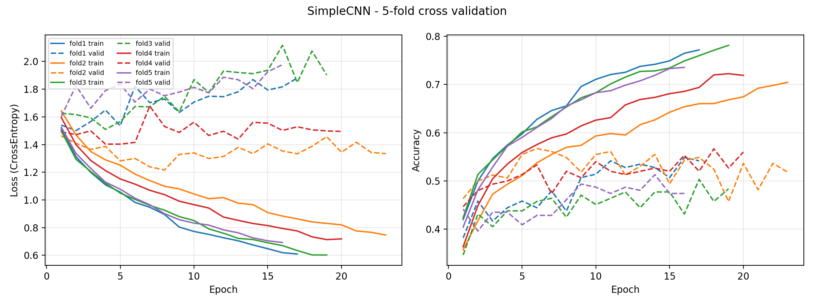
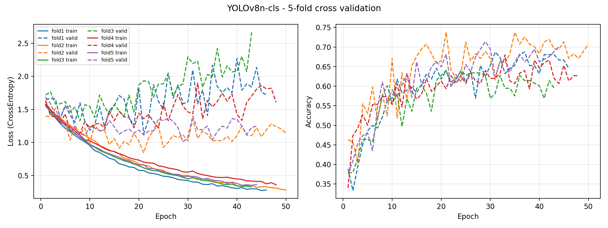
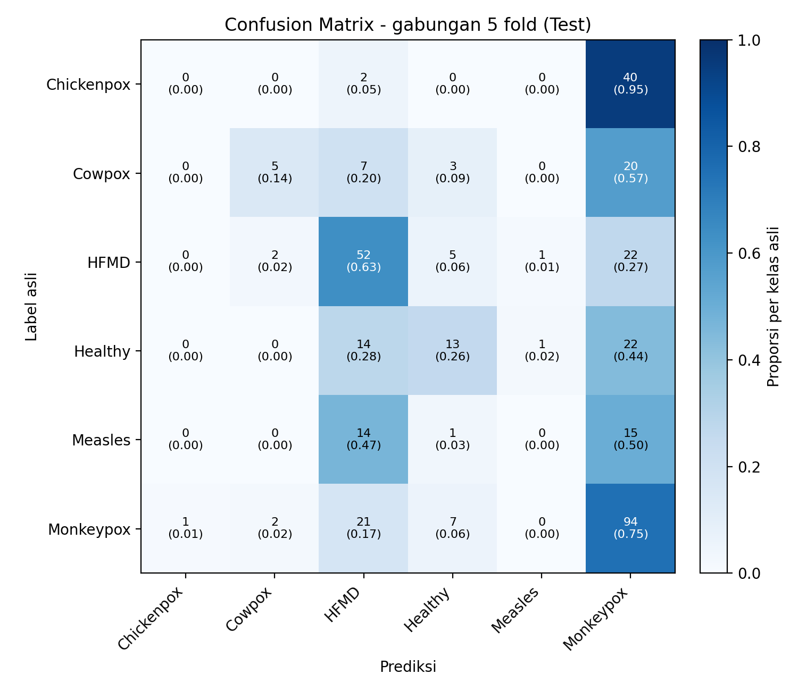
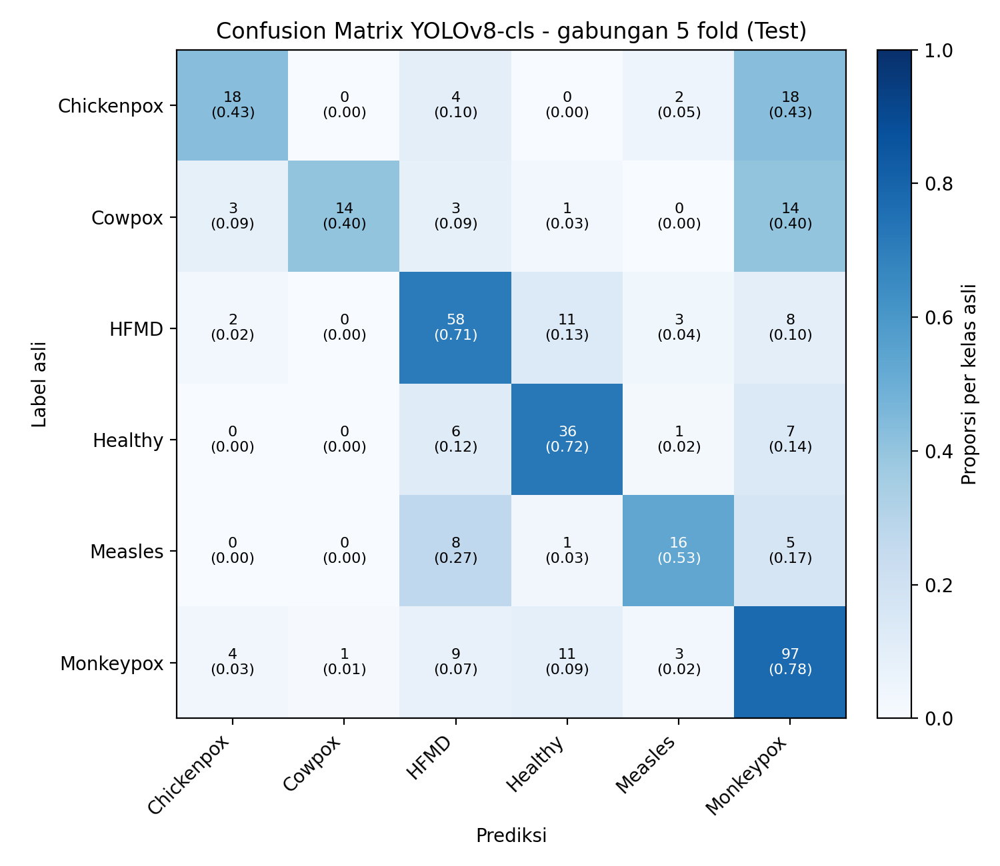
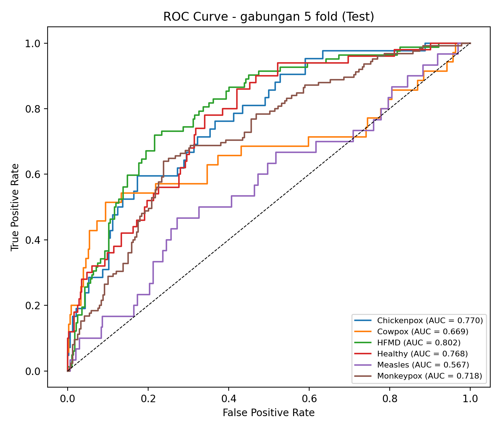
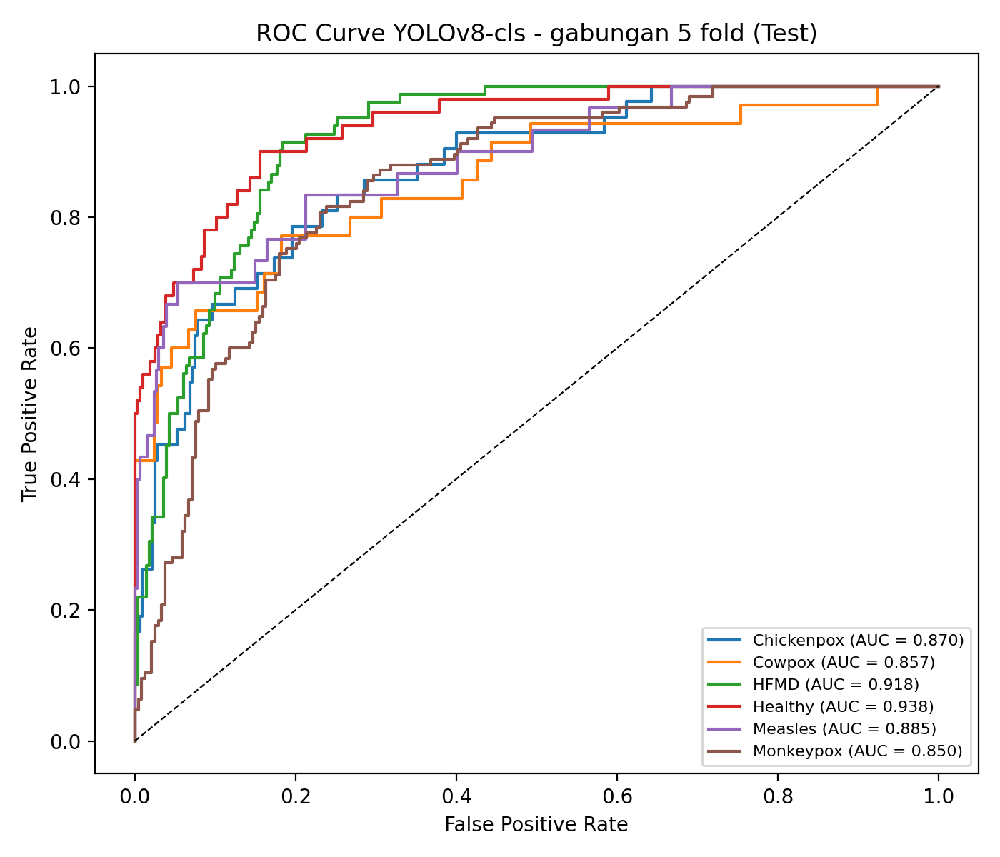

# Klasifikasi Citra Lesi Kulit Mpox: Perbandingan SimpleCNN, ModifiedCNN, dan YOLOv8-cls dengan 5-Fold Cross Validation

> **Status:** hasil Test SimpleCNN dan ModifiedCNN sudah final. Hasil Test YOLOv8-cls (nilai `XX,XX` dan gambar confusion matrix/ROC YOLO) diisi setelah `test_yolo.py` dijalankan dan folder `Results/YOLO/` di-push lengkap. Bagian bertanda `TODO` diisi manual.

| Penulis | Afiliasi |
|---|---|
| TODO: Nama Penulis (NIM) | TODO: Departemen, Nama Organisasi, Kota, Negara, email |

**Abstrak —** Penularan mpox yang meningkat di berbagai benua menuntut identifikasi pembawa penyakit sejak dini, sementara jumlah ahli yang dapat menilai ciri-ciri lesi kulit terbatas. Penelitian ini membangun sistem klasifikasi citra kulit ke dalam enam kelas, yaitu Monkeypox, Chickenpox, Measles, Cowpox, HFMD, dan Healthy, menggunakan Mpox Skin Lesion Dataset v2.0 (MSLD v2.0). Tiga model dibandingkan, semuanya dilatih dari nol tanpa bobot pretrained: SimpleCNN (dua blok konvolusi) sebagai baseline, ModifiedCNN (empat blok konvolusi 3×3 dengan global average pooling), dan YOLOv8n-cls. Data latih terdiri dari citra Original Train dan Augmented Train, sedangkan Original Valid dan Original Test hanya digunakan untuk validasi dan pengujian. Kinerja diukur dengan rerata 5-fold cross validation pada data Test. SimpleCNN menghasilkan akurasi 44,76%, F1-score macro 27,55%, dan ROC-AUC 0,735. ModifiedCNN meningkatkannya menjadi akurasi 61,87%, F1-score macro 53,28%, dan ROC-AUC 0,864. YOLOv8n-cls mencapai akurasi XX,XX%, F1-score macro XX,XX%, dan ROC-AUC X,XXX. TODO: simpulkan satu kalimat tentang model terbaik.

***Kata kunci—*** mpox, klasifikasi citra, convolutional neural network, YOLO, cross validation, lesi kulit

---

## I. PENDAHULUAN

Kasus mpox (monkeypox) meningkat signifikan di sejumlah negara di Afrika, Eropa, Amerika, hingga Asia, dan dikhawatirkan meluas seperti pandemi Covid-19 pada 2020. Pencegahan penularan memerlukan identifikasi pembawa penyakit (*carrier*) sebelum menularkan kepada orang di sekitarnya. Penginderaan jarak jauh dengan kamera berkualitas tinggi dapat memberi peringatan dini, tetapi penilaian apakah ciri pada kulit termasuk mpox atau bukan masih bergantung pada ahli yang jumlahnya terbatas.

Mpox Skin Lesion Dataset v2.0 (MSLD v2.0) [1], [2] menyediakan 755 citra asli dari 541 pasien pada enam kelas, dengan pembagian 5-fold dan citra augmentasi untuk data latih. Penulis dataset mengevaluasi beberapa arsitektur CNN pretrained, seperti VGG16, ResNet50, DenseNet121, MobileNetV2, EfficientNetB3, InceptionV3, dan Xception [1]. Penelitian ini mengambil arah yang berbeda: model yang dilatih dari nol, dimulai dari SimpleCNN sebagai baseline, lalu diperbaiki menjadi ModifiedCNN, dan dibandingkan dengan YOLOv8n-cls [8], [9] sebagai model dari keluarga arsitektur lain.

Rumusan masalahnya adalah seberapa baik ketiga model tersebut, bila dilatih hanya dengan data MSLD v2.0, mengklasifikasikan citra Monkeypox dan penyakit kulit lain, dan seberapa besar perbaikan arsitektur mengurangi masalah *overfitting* pada baseline. Tujuan penelitian adalah membangun dan membandingkan ketiga model menggunakan confusion matrix, accuracy, precision, recall, F1-score, dan ROC-AUC dari rerata 5-fold cross validation.

## KAJIAN TEORI

### A. Convolutional Neural Network (CNN)

CNN [3] mengekstraksi fitur spasial citra melalui lapisan konvolusi, fungsi aktivasi ReLU, dan *max pooling*, lalu mengklasifikasikan fitur tersebut dengan lapisan *fully connected*. *Batch normalization* [4] menstabilkan pelatihan, sedangkan *dropout* [5] mengurangi *overfitting*. Susunan beberapa konvolusi 3×3 berturut-turut dalam satu blok [11] dan *global average pooling* [12] yang menggantikan lapisan *flatten* adalah dua teknik yang dipakai pada ModifiedCNN untuk mengurangi jumlah parameter pada lapisan *fully connected*.

### B. YOLO untuk Klasifikasi

YOLO [9] awalnya dikenal sebagai detektor objek. Ultralytics YOLOv8 [8] juga menyediakan varian klasifikasi (*-cls*) dengan *backbone* CSP (blok C2f) dan *head* klasifikasi berupa konvolusi, *global average pooling*, dan lapisan linear. Varian klasifikasi dipilih karena MSLD v2.0 hanya memiliki label per citra tanpa *bounding box*.

### C. Fungsi Loss

Untuk klasifikasi $C$ kelas digunakan *cross-entropy* dengan $y_{i,c}$ label *one-hot* dan $\hat{p}_{i,c}$ probabilitas *softmax*:

$$\mathcal{L} = -\frac{1}{N}\sum_{i=1}^{N}\sum_{c=1}^{C} y_{i,c}\,\log \hat{p}_{i,c} \tag{1}$$

### D. Metrik Evaluasi

Dengan TP, TN, FP, FN berturut-turut *true positive*, *true negative*, *false positive*, dan *false negative* per kelas:

$$\text{Accuracy}=\frac{TP+TN}{TP+TN+FP+FN} \tag{2}$$

$$\text{Precision}=\frac{TP}{TP+FP},\qquad \text{Recall}=\frac{TP}{TP+FN} \tag{3}$$

$$F_1 = 2\cdot\frac{\text{Precision}\cdot\text{Recall}}{\text{Precision}+\text{Recall}} \tag{4}$$

Precision, recall, dan $F_1$ pada enam kelas dirata-ratakan secara *macro* (utama) dan *weighted* (pembanding). ROC-AUC dihitung dengan skema *one-vs-rest* lalu dirata-ratakan secara *macro*. *Confusion matrix* menunjukkan jumlah prediksi benar dan salah pada tiap pasangan kelas.

## II. METODE

### A. Dataset dan Aturan Penggunaan Data

Dataset: [Mpox Skin Lesion Dataset Version 2.0 (MSLD v2.0)](https://www.kaggle.com/datasets/joydippaul/mpox-skin-lesion-dataset-version-20-msld-v20) di Kaggle, dengan enam kelas (Chickenpox, Cowpox, Healthy, HFMD, Measles, Monkeypox). Dataset terdiri dari *Original Images* (5 fold, masing-masing berisi Train, Valid, Test) dan *Augmented Images* (5 fold, hanya Train).

| Split | Sumber data |
|---|---|
| Train | Original Train **+** Augmented Train |
| Valid | Original Valid saja |
| Test | Original Test saja |

Valid dan Test tidak pernah dipakai untuk training, dan tidak ada dataset atau bobot pretrained dari luar yang digunakan. Ketiga model memakai pembagian data yang identik. Jumlah citra Test per fold adalah 74, 82, 64, 81, dan 63 (total 364).

TODO: tempel keluaran `python -m Utils.getData` (jumlah gambar per kelas dan split) sebagai Tabel 1.

### B. Pre-processing

1. Pembacaan citra RGB dan perubahan ukuran menjadi $128\times128$ piksel (`INTER_AREA`).
2. Normalisasi per kanal dengan rerata dan simpangan baku yang dihitung dari data **Train** tiap fold, lalu dipakai juga untuk Valid dan Test (SimpleCNN dan ModifiedCNN).
3. Opsional `--clahe`: *Contrast Limited Adaptive Histogram Equalization* [6] pada kanal L (ruang warna LAB).
4. Opsional `--online_aug`: augmentasi tambahan pada data Train (flip, rotasi ±25°, variasi kecerahan dan kontras).

Pada seluruh eksperimen yang dilaporkan, `--clahe` dan `--online_aug` **tidak** diaktifkan, agar perbedaan hasil hanya berasal dari arsitektur. YOLOv8-cls memakai augmentasi bawaan Ultralytics selama training.

### C. Arsitektur

**1) SimpleCNN (baseline).** Dua blok konvolusi, ditambah *batch normalization* dan *dropout*. Untuk input $3\times128\times128$:

| Lapisan | Konfigurasi | Output |
|---|---|---|
| Conv Block 1 | Conv 5×5 (20 filter) → BatchNorm → ReLU → MaxPool 3×3 | 20×41×41 |
| Conv Block 2 | Conv 5×5 (50 filter) → BatchNorm → ReLU → MaxPool 3×3 | 50×12×12 |
| Flatten | | 7200 |
| FC 1 | Dropout(0,5) → Linear 7200→128 → ReLU | 128 |
| FC 2 | Dropout(0,5) → Linear 128→6 | 6 (logit) |

Jumlah parameter: **949.212**, dengan 922.502 (97%) berada di lapisan *fully connected*. Pada hasil training, valid loss terendah dicapai sangat awal (epoch 1 sampai 8), yang menunjukkan model cepat *overfitting*. Lapisan FC yang dominan inilah yang menjadi sasaran perbaikan pada ModifiedCNN.

**2) ModifiedCNN.** Empat blok konvolusi, tiap blok berisi dua konvolusi 3×3 (Conv → BatchNorm → ReLU), diikuti *global average pooling*:

| Lapisan | Konfigurasi | Output |
|---|---|---|
| Blok 1 | 2 × [Conv 3×3 (32) → BN → ReLU] → MaxPool 2×2 | 32×64×64 |
| Blok 2 | 2 × [Conv 3×3 (64) → BN → ReLU] → MaxPool 2×2 → Dropout2d(0,1) | 64×32×32 |
| Blok 3 | 2 × [Conv 3×3 (128) → BN → ReLU] → MaxPool 2×2 → Dropout2d(0,1) | 128×16×16 |
| Blok 4 | 2 × [Conv 3×3 (256) → BN → ReLU] → MaxPool 2×2 → Dropout2d(0,1) | 256×8×8 |
| Global Average Pooling | | 256 |
| FC 1 | Dropout(0,4) → Linear 256→256 → ReLU | 256 |
| FC 2 | Dropout(0,4) → Linear 256→6 | 6 (logit) |

Jumlah parameter: **1.240.550**, dengan hanya 67.334 (5%) di lapisan *fully connected*. Bobot konvolusi diinisialisasi Kaiming.

**Tabel A. Rincian perubahan SimpleCNN → ModifiedCNN.**

| Aspek | SimpleCNN | ModifiedCNN | Alasan |
|---|---|---|---|
| Blok konvolusi | 2 | 4 | Fitur lebih dalam dan bertingkat |
| Konvolusi per blok | 1 | 2 | Kapasitas ekstraksi fitur naik |
| Kernel | 5×5 | 3×3 (padding *same*) | Lebih efisien, ukuran fitur tidak menyusut |
| Jumlah filter | 20 → 50 | 32 → 64 → 128 → 256 | Fitur lebih kaya |
| Pooling | MaxPool 3×3 | MaxPool 2×2 | Detail lesi lebih terjaga |
| Konversi ke vektor | Flatten (7200 fitur) | Global Average Pooling (256 fitur) | Menghilangkan sumber *overfitting* utama |
| Bias konvolusi | Ada | Tidak ada | BatchNorm sudah memiliki bias |
| Hidden dim FC | 128 | 256 | Kapasitas *head* klasifikasi |
| Dropout FC | 0,5 | 0,4 | GAP sudah mengurangi *overfitting* |
| Dropout konvolusi | Tidak ada | Dropout2d 0,1 (blok 2 sampai 4) | Regularisasi tambahan |
| Inisialisasi bobot | Default PyTorch | Kaiming | Sesuai aktivasi ReLU |
| Weight decay | 1e-4 | 5e-4 | Regularisasi lebih kuat |
| Parameter total | 949.212 | 1.240.550 | Parameter berpindah dari FC ke konvolusi |
| Parameter di FC | 922.502 (97%) | 67.334 (5%) | |

**3) YOLOv8n-cls.** Varian *nano* dari Ultralytics YOLOv8 untuk klasifikasi, dibangun dari file konfigurasi `yolov8n-cls.yaml` (bukan `.pt` pretrained) sehingga dilatih dari nol. Dengan 6 kelas, model memiliki 56 lapisan dan **1.445.974** parameter. Pada MSLD v2.0, YOLO dipakai dalam mode klasifikasi, bukan deteksi objek.

### D. Pelatihan

| Parameter | SimpleCNN | ModifiedCNN | YOLOv8n-cls |
|---|---|---|---|
| Loss | CrossEntropy | CrossEntropy | CrossEntropy |
| Optimizer | Adam | Adam | AdamW |
| Learning rate | 0,001 | 0,001 | 0,001 |
| Weight decay | 1e-4 | 5e-4 | 5e-4 |
| Dropout | 0,5 (FC) | 0,4 (FC), 0,1 (konv.) | 0,3 (*head*) |
| Batch size | 32 | 32 | 32 |
| Epoch maksimum | 100 | 100 | 60 |
| *Early stopping* | sabar 15 epoch (valid loss) | sabar 15 epoch (valid loss) | sabar 15 epoch (akurasi Valid) |
| Ukuran citra | 128×128 | 128×128 | 128×128 |
| Seed | 42 + nomor fold | 42 + nomor fold | 42 + nomor fold |
| Checkpoint | valid loss terendah | valid loss terendah | akurasi Valid tertinggi |
| Augmentasi online | tidak | tidak | bawaan Ultralytics |

Checkpoint selalu dipilih dari data **Valid**, bukan Test. Perlu dicatat bahwa kriteria pemilihan checkpoint YOLO (akurasi Valid) berbeda dari kedua model CNN (valid loss), karena itulah mekanisme bawaan Ultralytics.

### E. 5-Fold Cross Validation dan Evaluasi

Model dilatih terpisah pada fold 1 sampai 5 (*Train* → *Valid* untuk memilih checkpoint), lalu diuji pada *Original Test* fold yang sama. Seluruh metrik dilaporkan sebagai **rerata ± simpangan baku dari 5 fold**. Confusion matrix dan kurva ROC gabungan dibuat dari prediksi Test seluruh fold.

## III. HASIL DAN PEMBAHASAN

### A. Ringkasan Perbandingan Ketiga Model

**Tabel 2.** Rerata ± simpangan baku 5 fold pada data Test (dalam %, kecuali ROC-AUC).

| Model | Parameter | Accuracy | Precision (macro) | Recall (macro) | F1 (macro) | ROC-AUC |
|---|---|---|---|---|---|---|
| SimpleCNN | 949.212 | 44,76 ± 8,79 | 28,52 ± 11,34 | 30,83 ± 6,63 | 27,55 ± 8,09 | 0,735 ± 0,031 |
| ModifiedCNN | 1.240.550 | **61,87 ± 6,60** | **62,80 ± 16,31** | **51,76 ± 9,38** | **53,28 ± 11,56** | **0,864 ± 0,056** |
| YOLOv8n-cls | 1.445.974 | XX,XX ± X,XX | XX,XX ± X,XX | XX,XX ± X,XX | XX,XX ± X,XX | X,XXX ± X,XXX |

> TODO: setelah nilai YOLO terisi, tebalkan nilai terbaik pada tiap kolom (tanda tebal di atas saat ini ada pada ModifiedCNN karena baru dua model yang sudah punya hasil Test).

Hasil YOLOv8-cls pada data **Valid** (akurasi pada epoch checkpoint terpilih) sudah tersedia dari `training_history.json`, dan dapat dibandingkan dengan kedua model lain pada kondisi yang sama:

**Tabel 3.** Akurasi Valid pada epoch checkpoint terpilih (%).

| Model | Fold 1 | Fold 2 | Fold 3 | Fold 4 | Fold 5 | Rerata ± std |
|---|---|---|---|---|---|---|
| SimpleCNN | 45,83 | 54,88 | 43,79 | 51,33 | 44,16 | 48,00 ± 4,89 |
| ModifiedCNN | 51,39 | 76,22 | 54,90 | 70,00 | 59,74 | 62,45 ± 10,41 |
| YOLOv8n-cls | 68,75 | 73,78 | 64,05 | 68,00 | 71,43 | 69,20 ± 3,68 |

Angka Valid bukan hasil akhir dan tidak boleh dipakai sebagai klaim kinerja, karena data Valid ikut menentukan pemilihan checkpoint. Angka ini hanya gambaran awal sebelum hasil Test YOLO tersedia.

### B. Hasil per Fold pada Data Test

**Tabel 4.** SimpleCNN (dalam %, kecuali ROC-AUC).

| Fold | n Test | Accuracy | Precision (macro) | Recall (macro) | F1 (macro) | ROC-AUC |
|---|---|---|---|---|---|---|
| 1 | 74 | 47,30 | 21,90 | 29,73 | 23,76 | 0,753 |
| 2 | 82 | 54,88 | 43,74 | 34,89 | 34,58 | 0,748 |
| 3 | 64 | 50,00 | 37,54 | 39,77 | 37,81 | 0,731 |
| 4 | 81 | 38,27 | 18,76 | 26,79 | 21,72 | 0,683 |
| 5 | 63 | 33,33 | 20,66 | 22,96 | 19,88 | 0,760 |
| **Rerata ± std** | | 44,76 ± 8,79 | 28,52 ± 11,34 | 30,83 ± 6,63 | 27,55 ± 8,09 | 0,735 ± 0,031 |

**Tabel 5.** ModifiedCNN (dalam %, kecuali ROC-AUC).

| Fold | n Test | Accuracy | Precision (macro) | Recall (macro) | F1 (macro) | ROC-AUC |
|---|---|---|---|---|---|---|
| 1 | 74 | 59,46 | 45,51 | 43,20 | 40,59 | 0,843 |
| 2 | 82 | 65,85 | 67,04 | 56,48 | 59,79 | 0,848 |
| 3 | 64 | 51,56 | 45,83 | 40,39 | 41,06 | 0,790 |
| 4 | 81 | 64,20 | 75,75 | 56,92 | 59,98 | 0,923 |
| 5 | 63 | 68,25 | 79,86 | 61,80 | 64,97 | 0,917 |
| **Rerata ± std** | | 61,87 ± 6,60 | 62,80 ± 16,31 | 51,76 ± 9,38 | 53,28 ± 11,56 | 0,864 ± 0,056 |

**Tabel 6.** YOLOv8n-cls (dalam %, kecuali ROC-AUC). TODO: salin dari `Results/YOLO/metrics_per_fold.csv`.

| Fold | n Test | Accuracy | Precision (macro) | Recall (macro) | F1 (macro) | ROC-AUC |
|---|---|---|---|---|---|---|
| 1 | 74 | XX,XX | XX,XX | XX,XX | XX,XX | X,XXX |
| 2 | 82 | XX,XX | XX,XX | XX,XX | XX,XX | X,XXX |
| 3 | 64 | XX,XX | XX,XX | XX,XX | XX,XX | X,XXX |
| 4 | 81 | XX,XX | XX,XX | XX,XX | XX,XX | X,XXX |
| 5 | 63 | XX,XX | XX,XX | XX,XX | XX,XX | X,XXX |
| **Rerata ± std** | | XX,XX ± X,XX | XX,XX ± X,XX | XX,XX ± X,XX | XX,XX ± X,XX | X,XXX ± X,XXX |

### C. Gambar

**Gambar 1.** Kurva loss dan akurasi training per fold (garis putus-putus = Valid).

SimpleCNN:



ModifiedCNN:


YOLOv8n-cls (akurasi train tidak dihitung oleh Ultralytics, sehingga hanya kurva Valid yang berisi):



**Gambar 2.** Confusion matrix gabungan 5 fold pada data Test.

SimpleCNN:



ModifiedCNN:


YOLOv8n-cls (tampil setelah `Results/YOLO/` hasil `test_yolo.py` di-push):



**Gambar 3.** Kurva ROC one-vs-rest gabungan 5 fold pada data Test.

SimpleCNN:



ModifiedCNN:


YOLOv8n-cls:



### D. Pembahasan

**Perbaikan dari SimpleCNN ke ModifiedCNN.** ModifiedCNN menaikkan akurasi Test rerata dari 44,76% menjadi 61,87% (+17,11 poin), F1-score macro dari 27,55% menjadi 53,28% (+25,73 poin), dan ROC-AUC dari 0,735 menjadi 0,864. Kenaikan ini konsisten di kelima fold untuk akurasi, F1 macro, dan ROC-AUC. Pada SimpleCNN, valid loss terendah dicapai pada epoch 1 sampai 8, sedangkan pada ModifiedCNN pada epoch 9 sampai 26. Artinya model dapat belajar lebih lama sebelum mulai *overfitting*, yang sejalan dengan dugaan bahwa lapisan *flatten* + FC yang menyimpan 97% parameter pada baseline adalah sumber masalah utamanya. Penjelasan ini masih berupa dugaan, karena perubahan dilakukan bersamaan (kedalaman, kernel, GAP, dropout, weight decay) dan pengaruh masing-masing belum diuji lewat *ablation*.

**Kelas yang sulit.** Confusion matrix gabungan ModifiedCNN menunjukkan Monkeypox dikenali paling baik (recall 82%, 102 dari 125 citra), diikuti HFMD (76%) dan Healthy (52%). Kelas minoritas jauh lebih lemah: Chickenpox 31%, Cowpox 37%, dan Measles 33%. Kesalahan terbesar adalah citra Chickenpox (23 dari 42) dan Cowpox (17 dari 35) yang diprediksi sebagai Monkeypox, serta Measles yang tersebar ke Monkeypox (9 dari 30) dan HFMD (7 dari 30). Pola ini menunjukkan model cenderung memilih kelas mayoritas, dan *class-weighted loss* menjadi kandidat perbaikan berikutnya. Ini juga menjelaskan mengapa precision macro (62,80%) jauh lebih tinggi daripada recall macro (51,76%).

**Variasi antar fold.** Simpangan baku akurasi ModifiedCNN adalah 6,60 poin, dengan fold 3 paling rendah (51,56%) dan fold 5 paling tinggi (68,25%). Jumlah citra Test hanya 63 sampai 82 per fold, sehingga satu atau dua citra mengubah akurasi sekitar 1 sampai 3 poin. Selisih antar model yang kecil perlu dibaca dengan hati-hati, sedangkan selisih SimpleCNN ke ModifiedCNN (belasan poin) cukup besar dibanding variasi tersebut.

**Kesenjangan train dan valid.** Pada epoch checkpoint, akurasi train ModifiedCNN berkisar 66% sampai 88% dan akurasi Valid 51% sampai 76%. Kesenjangan ini menunjukkan masih ada *overfitting* ringan sampai sedang, dan rata-rata Valid (62,45%) dekat dengan rata-rata Test (61,87%).

**YOLOv8n-cls.** TODO: isi setelah hasil Test tersedia. Poin yang dapat dibahas: (1) apakah YOLOv8n-cls melampaui ModifiedCNN pada Test, mengingat akurasi Valid-nya lebih tinggi (69,20% dibanding 62,45%) dan lebih stabil antar fold (std 3,68 dibanding 10,41), (2) pengaruh augmentasi bawaan Ultralytics yang tidak dipakai pada dua model lain, sehingga perbandingan bukan murni arsitektur, (3) kelas yang paling sering salah dibanding ModifiedCNN, dan (4) jumlah epoch yang lebih panjang (checkpoint terbaik pada epoch 21 sampai 33).

**Keterbatasan.** Tiga hal membatasi kesimpulan: citra Test per fold sedikit, distribusi kelas tidak seimbang, dan perbandingan dengan YOLO tidak sepenuhnya setara (optimizer, augmentasi, dan kriteria checkpoint berbeda). Pengembangan yang dapat dilakukan: *class-weighted loss*, augmentasi online pada seluruh model (`--online_aug`), *ablation* untuk tiap perubahan arsitektur, dan *explainability* (Grad-CAM).

## IV. KESIMPULAN

TODO: satu atau dua paragraf (tanpa poin). Isi: (1) ModifiedCNN memperbaiki SimpleCNN secara jelas, yaitu akurasi 44,76% → 61,87% dan F1 macro 27,55% → 53,28%, (2) hasil YOLOv8n-cls dan model terbaik di antara ketiganya setelah hasil Test tersedia, (3) kelas yang paling sulit (Chickenpox, Cowpox, Measles), dan (4) saran pengembangan.

## REFERENSI

[1] S. N. Ali *et al.*, "A web-based mpox skin lesion detection system using state-of-the-art deep learning models considering racial diversity," arXiv:2306.14169, 2023.

[2] J. Paul, "Mpox Skin Lesion Dataset Version 2.0 (MSLD v2.0)." Internet: https://www.kaggle.com/datasets/joydippaul/mpox-skin-lesion-dataset-version-20-msld-v20 [accessed: 2026].

[3] Y. LeCun, L. Bottou, Y. Bengio, and P. Haffner, "Gradient-based learning applied to document recognition," *Proc. IEEE*, vol. 86, no. 11, pp. 2278–2324, Nov. 1998.

[4] S. Ioffe and C. Szegedy, "Batch normalization: Accelerating deep network training by reducing internal covariate shift," in *Proc. ICML*, 2015, pp. 448–456.

[5] N. Srivastava, G. Hinton, A. Krizhevsky, I. Sutskever, and R. Salakhutdinov, "Dropout: A simple way to prevent neural networks from overfitting," *J. Mach. Learn. Res.*, vol. 15, pp. 1929–1958, 2014.

[6] K. Zuiderveld, "Contrast limited adaptive histogram equalization," in *Graphics Gems IV*, P. S. Heckbert, Ed. San Diego, CA: Academic Press, 1994, pp. 474–485.

[7] D. P. Kingma and J. Ba, "Adam: A method for stochastic optimization," arXiv:1412.6980, 2014.

[8] G. Jocher, A. Chaurasia, and J. Qiu, "Ultralytics YOLOv8," 2023. Internet: https://github.com/ultralytics/ultralytics [accessed: 2026].

[9] J. Redmon, S. Divvala, R. Girshick, and A. Farhadi, "You only look once: Unified, real-time object detection," in *Proc. IEEE CVPR*, 2016, pp. 779–788.

[10] I. Loshchilov and F. Hutter, "Decoupled weight decay regularization," in *Proc. ICLR*, 2019.

[11] K. Simonyan and A. Zisserman, "Very deep convolutional networks for large-scale image recognition," in *Proc. ICLR*, 2015.

[12] M. Lin, Q. Chen, and S. Yan, "Network in network," arXiv:1312.4400, 2013.

---

## Lampiran: Struktur Repositori dan Cara Menjalankan

```
.
├── Models/
│   ├── CNN.py              # SimpleCNN (baseline)
│   ├── ModifiedCNN.py      # ModifiedCNN
│   └── YOLO.py             # pembungkus YOLOv8-cls (siapkan data, train, prediksi)
├── Utils/
│   ├── getData.py          # penemuan fold, pre-processing, Dataset (getImageLabel)
│   └── evaluate.py         # metrik, confusion matrix, ROC, plot training
├── train.py                # training 5-fold SimpleCNN/ModifiedCNN -> Checkpoints/ (tidak di-commit)
├── test.py                 # testing 5-fold SimpleCNN/ModifiedCNN -> Results/
├── train_yolo.py           # training 5-fold YOLOv8-cls
├── test_yolo.py            # testing 5-fold YOLOv8-cls
├── Results/
│   ├── CNN/                # hasil SimpleCNN
│   ├── ModifiedCNN/        # hasil ModifiedCNN
│   └── YOLO/               # hasil YOLOv8n-cls
├── requirements.txt
└── .gitignore              # memblokir *.pt, *.pth, *.h5, Checkpoints/, Dataset/, runs/
```

**Menjalankan di Kaggle**

1. Buat notebook baru. *Add Input* → dataset MSLD v2.0. *Settings* → Accelerator **GPU**, Internet **On**.
2. `git clone` repo ini, lalu `pip install -r requirements.txt`.
3. Jalankan perintah di bawah sesuai model yang diinginkan.
4. Unduh folder `Results/<model>/` dari tab *Output* (atau lewat Git), lalu commit ke repo. Folder checkpoint tidak di-commit.

**SimpleCNN**

```bash
pip install -r requirements.txt
python -m Utils.getData --data_root /kaggle/input     # cek struktur dataset
python train.py --data_root /kaggle/input --epochs 100
python test.py  --data_root /kaggle/input
```

**ModifiedCNN.** `train.py` dan `test.py` memakai `SimpleCNN` secara langsung, sehingga salinan yang memakai ModifiedCNN dibuat dengan mengganti satu baris import, tanpa mengubah file asli:

```bash
sed 's/from Models.CNN import SimpleCNN/from Models.ModifiedCNN import ModifiedCNN as SimpleCNN/' train.py > train_modified.py
sed 's/from Models.CNN import SimpleCNN/from Models.ModifiedCNN import ModifiedCNN as SimpleCNN/' test.py  > test_modified.py

python train_modified.py --data_root /kaggle/input --epochs 100 \
  --hidden_dim 256 --dropout 0.4 --weight_decay 5e-4 \
  --ckpt_dir ./Checkpoints_Modified --out_dir ./Results/ModifiedCNN
python test_modified.py --data_root /kaggle/input \
  --ckpt_dir ./Checkpoints_Modified --out_dir ./Results/ModifiedCNN
```

**YOLOv8n-cls**

```bash
pip install ultralytics
python train_yolo.py --data_root /kaggle/input --epochs 60
python test_yolo.py  --data_root /kaggle/input
# ukuran lebih besar: --variant s  atau  --variant m
```

**Uji cepat:** tambahkan `--folds 1 --epochs 2` pada perintah training dan `--folds 1` pada perintah testing.

**Kepatuhan aturan tugas:** model hasil training (`*.pt`, `*.pth`, `*.h5`, dll.) dan dataset tidak diunggah (diblokir `.gitignore`); Valid/Test tidak dipakai untuk training; tidak ada dataset atau bobot pretrained dari luar.
