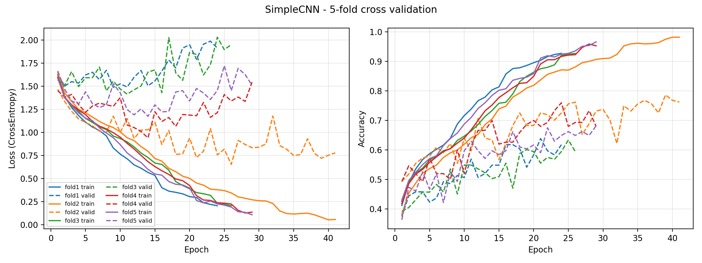
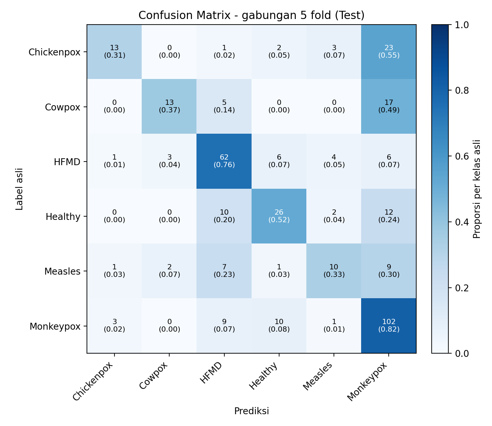
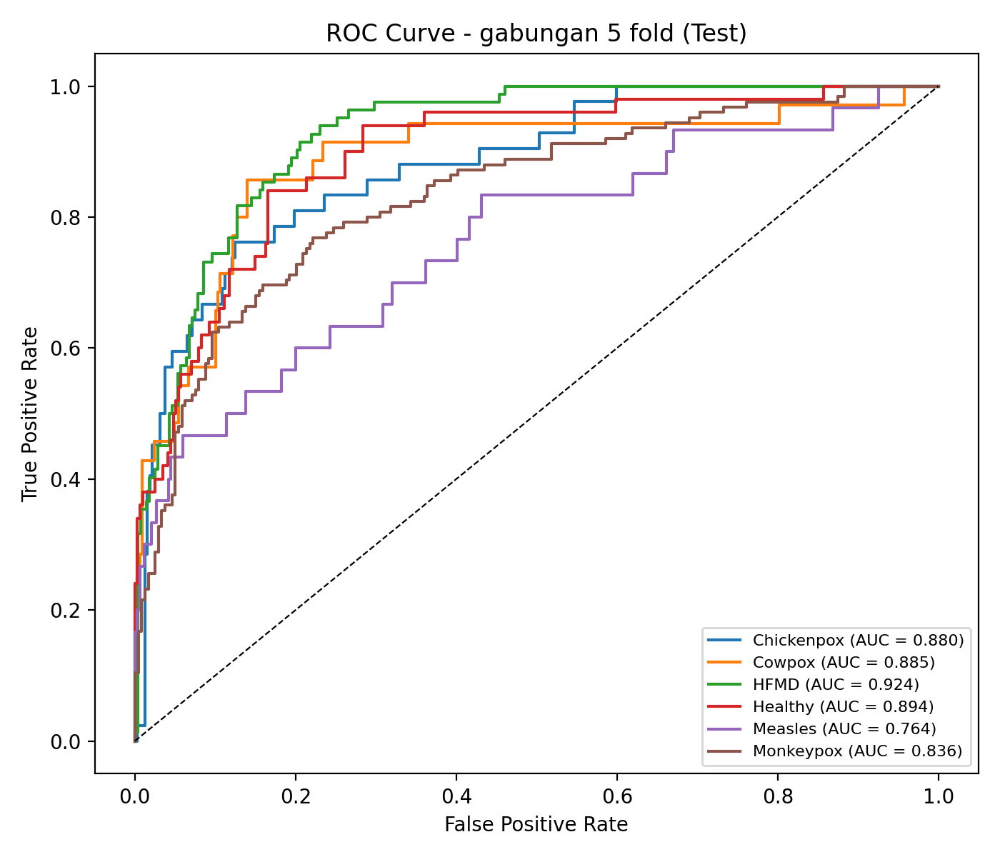

# Klasifikasi Citra Lesi Kulit Mpox Menggunakan SimpleCNN dengan 5-Fold Cross Validation

> **Status:** kerangka laporan. Bagian bertanda `TODO` dan nilai `XX,XX` diisi setelah `train.py` dan `test.py` dijalankan di Kaggle. Gambar di bagian Hasil akan tampil setelah folder `Results/` di-push ke repositori ini.

| Penulis | Afiliasi |
|---|---|
| TODO: Nama Penulis (NIM) | TODO: Departemen, Nama Organisasi, Kota, Negara, email |

**Abstrak —** Penularan mpox yang meningkat di berbagai benua menuntut identifikasi pembawa penyakit sejak dini, sementara jumlah ahli yang dapat menilai ciri-ciri lesi kulit secara terus-menerus terbatas. Penelitian ini membangun sistem klasifikasi citra kulit ke dalam enam kelas, yaitu Monkeypox, Chickenpox, Measles, Cowpox, HFMD, dan Healthy, menggunakan Mpox Skin Lesion Dataset v2.0 (MSLD v2.0). Model yang digunakan adalah SimpleCNN dengan dua blok konvolusi yang dilatih dari nol tanpa bobot pretrained. Data latih terdiri dari citra Original Train dan Augmented Train, sedangkan Original Valid dan Original Test hanya digunakan untuk validasi dan pengujian. Pre-processing meliputi perubahan ukuran citra menjadi 128×128 piksel, normalisasi per kanal, serta opsi CLAHE dan augmentasi online. Pelatihan memakai fungsi loss CrossEntropy dan optimizer Adam, dan kinerja diukur dengan rerata 5-fold cross validation. Hasil pengujian menunjukkan akurasi XX,XX%, precision XX,XX%, recall XX,XX%, F1-score XX,XX%, dan ROC-AUC X,XXX. Hasil ini menunjukkan bahwa CNN sederhana TODO: simpulkan satu kalimat, dan menjadi dasar pengembangan arsitektur yang lebih dalam.

***Kata kunci—*** mpox, klasifikasi citra, convolutional neural network, cross validation, lesi kulit

---

## I. PENDAHULUAN

Kasus mpox (monkeypox) meningkat signifikan di sejumlah negara di Afrika, Eropa, Amerika, hingga Asia, dan dikhawatirkan meluas seperti pandemi Covid-19 pada 2020. Pencegahan penularan memerlukan identifikasi pembawa penyakit (*carrier*) sebelum menularkan kepada orang di sekitarnya. Penginderaan jarak jauh dengan kamera berkualitas tinggi dapat memberi peringatan dini, tetapi penilaian apakah ciri pada kulit termasuk mpox atau bukan masih bergantung pada ahli yang jumlahnya terbatas.

Mpox Skin Lesion Dataset v2.0 (MSLD v2.0) [1], [2] menyediakan 755 citra asli dari 541 pasien pada enam kelas, dengan pembagian 5-fold dan citra augmentasi untuk data latih. Penulis dataset mengevaluasi beberapa arsitektur CNN pretrained, seperti VGG16, ResNet50, DenseNet121, MobileNetV2, EfficientNetB3, InceptionV3, dan Xception [1]. Penelitian ini mengambil arah yang berbeda: sebuah CNN sederhana yang dilatih dari nol, dengan fokus pada pengaruh pre-processing dan evaluasi 5-fold cross validation yang ketat.

Rumusan masalahnya adalah seberapa baik SimpleCNN yang dilatih hanya dengan data MSLD v2.0 mengklasifikasikan citra Monkeypox dan penyakit kulit lain secara efisien, presisi, dan akurat. Tujuan penelitian adalah membangun dan mengevaluasi model tersebut menggunakan confusion matrix, accuracy, precision, recall, F1-score, dan ROC-AUC dari rerata 5-fold cross validation.

## KAJIAN TEORI

### A. Convolutional Neural Network (CNN)

CNN [3] mengekstraksi fitur spasial citra melalui lapisan konvolusi, fungsi aktivasi ReLU, dan *max pooling*, lalu mengklasifikasikan fitur tersebut dengan lapisan *fully connected*. *Batch normalization* [4] menstabilkan pelatihan, sedangkan *dropout* [5] mengurangi *overfitting*.

### B. Fungsi Loss

Untuk klasifikasi $C$ kelas digunakan *cross-entropy* dengan $y_{i,c}$ label *one-hot* dan $\hat{p}_{i,c}$ probabilitas *softmax*:

$$\mathcal{L} = -\frac{1}{N}\sum_{i=1}^{N}\sum_{c=1}^{C} y_{i,c}\,\log \hat{p}_{i,c} \tag{1}$$

### C. Metrik Evaluasi

Dengan TP, TN, FP, FN berturut-turut *true positive*, *true negative*, *false positive*, dan *false negative* per kelas:

$$\text{Accuracy}=\frac{TP+TN}{TP+TN+FP+FN} \tag{2}$$

$$\text{Precision}=\frac{TP}{TP+FP},\qquad \text{Recall}=\frac{TP}{TP+FN} \tag{3}$$

$$F_1 = 2\cdot\frac{\text{Precision}\cdot\text{Recall}}{\text{Precision}+\text{Recall}} \tag{4}$$

Precision, recall, dan $F_1$ pada enam kelas dirata-ratakan secara *macro* (utama) dan *weighted* (pembanding). ROC-AUC dihitung dengan skema *one-vs-rest* lalu dirata-ratakan secara *macro*. *Confusion matrix* menunjukkan jumlah prediksi benar dan salah pada tiap pasangan kelas.

## II. METODE

### A. Dataset dan Aturan Penggunaan Data

Dataset: [Mpox Skin Lesion Dataset Version 2.0 (MSLD v2.0)](https://www.kaggle.com/datasets/joydippaul/mpox-skin-lesion-dataset-version-20-msld-v20) di Kaggle, dengan enam kelas (Chickenpox, Cowpox, Healthy, HFMD, Measles, Monkeypox). Dataset terdiri dari *Original Images* (5 fold, masing-masing berisi Train, Valid, Test) dan *Augmented Images* (5 fold, hanya Train).

| Split | Sumber data |
|---|---|
| Train | Original Train **+** Augmented Train |
| Valid | Original Valid saja |
| Test | Original Test saja |

Valid dan Test tidak pernah dipakai untuk training, dan tidak ada dataset atau bobot pretrained dari luar yang digunakan.

TODO: tempel keluaran `python -m Utils.getData` (jumlah gambar per kelas dan split) sebagai Tabel 1.

### B. Pre-processing

1. Pembacaan citra RGB dan perubahan ukuran menjadi $128\times128$ piksel (`INTER_AREA`).
2. Normalisasi per kanal dengan rerata dan simpangan baku yang dihitung dari data **Train** tiap fold, lalu dipakai juga untuk Valid dan Test.
3. Opsional `--clahe`: *Contrast Limited Adaptive Histogram Equalization* [6] pada kanal L (ruang warna LAB) untuk memperjelas tekstur lesi.
4. Opsional `--online_aug`: augmentasi tambahan pada data Train (flip horizontal/vertikal, rotasi ±25°, variasi kecerahan dan kontras).

TODO: bandingkan konfigurasi pre-processing (misalnya tanpa/dengan `--clahe`, `--online_aug`) pada Tabel 3.

### C. Arsitektur SimpleCNN

Arsitektur mengikuti SimpleCNN pada M9 (dua blok konvolusi), ditambah *batch normalization* dan *dropout*. Untuk input $3\times128\times128$:

| Lapisan | Konfigurasi | Output |
|---|---|---|
| Conv Block 1 | Conv 5×5 (20 filter) → BatchNorm → ReLU → MaxPool 3×3 | 20×41×41 |
| Conv Block 2 | Conv 5×5 (50 filter) → BatchNorm → ReLU → MaxPool 3×3 | 50×12×12 |
| Flatten | | 7200 |
| FC 1 | Dropout(0,5) → Linear 7200→128 → ReLU | 128 |
| FC 2 | Dropout(0,5) → Linear 128→6 | 6 (logit) |

Model menghasilkan logit, bukan probabilitas. `nn.CrossEntropyLoss` sudah memuat log-softmax, sehingga *softmax* hanya diterapkan saat menghitung probabilitas untuk ROC-AUC. Jumlah parameter: TODO (dicetak saat training).

### D. Pelatihan

| Parameter | Nilai |
|---|---|
| Loss | `nn.CrossEntropyLoss` |
| Optimizer | Adam [7], lr = 0,001, weight decay = 1e-4 |
| Batch size | 32 |
| Epoch maksimum | 60, *early stopping* sabar 15 epoch pada valid loss |
| Scheduler | `ReduceLROnPlateau` (faktor 0,5, sabar 5 epoch) |
| Seed | 42 + nomor fold |
| Checkpoint | epoch dengan **valid loss terendah** (dipilih dari Valid, bukan Test) |

### E. 5-Fold Cross Validation dan Evaluasi

Model dilatih terpisah pada fold 1 sampai 5 (*Train* → *Valid* untuk memilih checkpoint), lalu diuji pada *Original Test* fold yang sama. Seluruh metrik dilaporkan sebagai **rerata ± simpangan baku dari 5 fold**. Confusion matrix dan kurva ROC gabungan dibuat dari prediksi Test seluruh fold.

## III. HASIL DAN PEMBAHASAN

> TODO: isi setelah test.py selesai. Tabel di bawah bisa disalin dari `Results/metrics_per_fold.csv` dan `Results/metrics_summary.csv`.

### A. Gambar

**Gambar 1.** Kurva loss dan akurasi training per fold (garis putus-putus = Valid).



**Gambar 2.** Confusion matrix gabungan 5 fold pada data Test.



**Gambar 3.** Kurva ROC one-vs-rest gabungan 5 fold pada data Test.



### B. Tabel

**Tabel 2.** Metrik pada data Test per fold dan rerata 5 fold.

| Fold | Accuracy | Precision (macro) | Recall (macro) | F1 (macro) | ROC-AUC |
|---|---|---|---|---|---|
| 1 | XX,XX | XX,XX | XX,XX | XX,XX | X,XXX |
| 2 | XX,XX | XX,XX | XX,XX | XX,XX | X,XXX |
| 3 | XX,XX | XX,XX | XX,XX | XX,XX | X,XXX |
| 4 | XX,XX | XX,XX | XX,XX | XX,XX | X,XXX |
| 5 | XX,XX | XX,XX | XX,XX | XX,XX | X,XXX |
| **Rerata ± std** | XX,XX ± X,XX | XX,XX ± X,XX | XX,XX ± X,XX | XX,XX ± X,XX | X,XXX ± X,XXX |

### C. Pembahasan

TODO: bahas (1) kelas yang paling sering salah diklasifikasikan berdasarkan confusion matrix (mis. Monkeypox vs Chickenpox/Measles), (2) selisih kurva train dan valid (indikasi *overfitting*), (3) pengaruh pre-processing, (4) keterbatasan CNN sederhana tanpa pretrained, dan (5) rencana pengembangan: arsitektur lebih dalam atau residual, *class-weighted loss*, dan *explainability* (Grad-CAM).

## IV. KESIMPULAN

TODO: satu atau dua paragraf (tanpa poin) berisi hasil utama rerata 5-fold, kelas yang paling sulit, dan saran pengembangan.

## REFERENSI

[1] S. N. Ali *et al.*, "A web-based mpox skin lesion detection system using state-of-the-art deep learning models considering racial diversity," arXiv:2306.14169, 2023.

[2] J. Paul, "Mpox Skin Lesion Dataset Version 2.0 (MSLD v2.0)." Internet: https://www.kaggle.com/datasets/joydippaul/mpox-skin-lesion-dataset-version-20-msld-v20 [accessed: 2026].

[3] Y. LeCun, L. Bottou, Y. Bengio, and P. Haffner, "Gradient-based learning applied to document recognition," *Proc. IEEE*, vol. 86, no. 11, pp. 2278–2324, Nov. 1998.

[4] S. Ioffe and C. Szegedy, "Batch normalization: Accelerating deep network training by reducing internal covariate shift," in *Proc. ICML*, 2015, pp. 448–456.

[5] N. Srivastava, G. Hinton, A. Krizhevsky, I. Sutskever, and R. Salakhutdinov, "Dropout: A simple way to prevent neural networks from overfitting," *J. Mach. Learn. Res.*, vol. 15, pp. 1929–1958, 2014.

[6] K. Zuiderveld, "Contrast limited adaptive histogram equalization," in *Graphics Gems IV*, P. S. Heckbert, Ed. San Diego, CA: Academic Press, 1994, pp. 474–485.

[7] D. P. Kingma and J. Ba, "Adam: A method for stochastic optimization," arXiv:1412.6980, 2014.

---

## Lampiran: Struktur Repositori dan Cara Menjalankan

```
.
├── Models/
│   └── CNN.py              # SimpleCNN
├── Utils/
│   ├── getData.py          # penemuan fold, pre-processing, Dataset (getImageLabel)
│   └── evaluate.py         # metrik, confusion matrix, ROC, plot training
├── train.py                # training 5-fold -> Checkpoints/ (tidak di-commit) + Results/training*.png
├── test.py                 # testing 5-fold -> Results/ (metrik, confusion matrix, ROC)
├── Kaggle_Run.ipynb        # notebook Kaggle: clone repo, train, test
├── Results/                # gambar & tabel hasil (di-commit)
├── requirements.txt
└── .gitignore              # memblokir *.pt, *.pth, *.h5, Checkpoints/, Dataset/
```

**Menjalankan di Kaggle**

1. Buat notebook baru, upload `Kaggle_Run.ipynb` (File → Import Notebook), atau salin sel-selnya.
2. *Add Input* → dataset MSLD v2.0. *Settings* → Accelerator **GPU**, Internet **On**.
3. Ubah `GITHUB_USER` dan `REPO_NAME`, lalu *Run All*. Notebook akan `git clone` repo ini, mengecek dataset, menjalankan `train.py` dan `test.py`.
4. Unduh `Results/` dari tab *Output* (atau pakai sel *push* opsional di notebook), lalu commit ke repo.

**Menjalankan manual**

```bash
pip install -r requirements.txt
python -m Utils.getData --data_root /kaggle/input     # cek struktur dataset
python train.py --data_root /kaggle/input --epochs 60
python test.py  --data_root /kaggle/input
# opsi pre-processing: --clahe  --online_aug  --img_size 128
# uji cepat: python train.py --folds 1 --epochs 2 && python test.py --folds 1
```

**Kepatuhan aturan tugas:** model hasil training (`*.pt`, `*.pth`, `*.h5`, dll.) dan dataset tidak diunggah (diblokir `.gitignore`); Valid/Test tidak dipakai untuk training; tidak ada dataset atau bobot pretrained dari luar.
